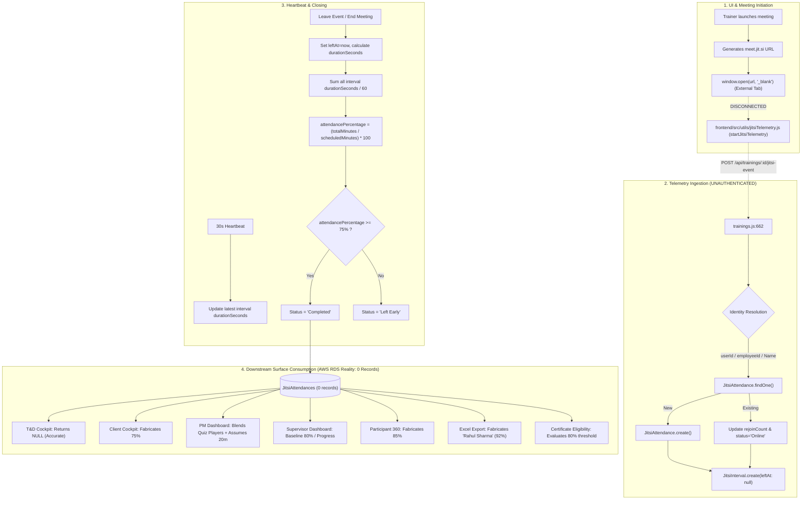

# RETAILEDGE PRO — STAGE 3C
## Attendance & Jitsi Data Audit: Comprehensive Diagnostic Report

**Document ID:** `REP-AUDIT-STAGE-3C-DIAGNOSTIC`  
**Execution Date:** 2026-10-14  
**Audit Type:** Read-Only Architectural, Data Integrity, and RBAC Security Audit  
**Target Environment:** AWS RDS PostgreSQL (`retailedgepro`)  
**Auditors:** Senior QA Architect, Backend Security Auditor, Data Integrity Specialist  
**Gate Decision:** **STAGE 3C AUDIT COMPLETE — HOLD FOR REMEDIATION (NO STAGE 3D WITHOUT AUTHORIZATION)**

---

## 1. Executive Summary

A comprehensive read-only diagnostic audit was conducted across the RetailEdge PRO Attendance Tracking and Jitsi meeting integration infrastructure on the live **AWS RDS PostgreSQL** environment. 

### Key Findings Overview
1. **Zero Persisted Telemetry Records:** The PostgreSQL tables `JitsiAttendances` and `JitsiIntervals` contain **0 records** in AWS RDS. 
2. **Frontend Telemetry Disconnection (Root Cause):** The telemetry tracker module (`frontend/src/utils/jitsiTelemetry.js`) is fully declared with join/heartbeat/leave event dispatchers, but is **never imported or invoked anywhere in the frontend application**. All meeting launchers open external `meet.jit.si` tabs via `window.open(url, '_blank')`, bypassing the backend telemetry collector completely.
3. **Critical Security Weakness:** The telemetry ingestion endpoint `POST /api/trainings/:id/jitsi-event` completely lacks authentication middleware (`requireAuth` omitted). Anyone on the network can forge unauthenticated attendance records.
4. **Widespread Metric Fabrication in Dashboards:** Because `JitsiAttendances` contains 0 records, multiple dashboard services fabricate plausible-looking metrics rather than reporting no data:
   - **Client Cockpit:** Fabricates a hardcoded **75%** attendance rate (`clientService.js:188`).
   - **Supervisor Dashboard:** Uses a baseline fallback of **80%** or substitutes Training Module Completion for attendance (`supervisorService.js:143`); drilldown defaults to **85%** (`SupervisorDashboard.jsx:1236`).
   - **PM Dashboard:** Combines Quiz Arena participants with Jitsi attendees into reach metrics and fabricates duration using an assumed **20 minutes per quiz session** (`projectIntelligenceService.js:224`).
   - **Participant 360:** Defaults average attendance to a hardcoded **85%** (`projectIntelligenceService.js:832`).
   - **Excel Master Outcome Report:** Injects hardcoded mock rows for "Rahul Sharma" (92% attendance, 73m duration) when rows are empty (`reportExcelGenerator.js:326-335`).
   - **T&D Manager Cockpit:** The **only** service that correctly returns `attendanceRate: null` and `hasAttendanceData: false` when records are missing (`tdService.js:378`).
5. **Threshold Discrepancies:** Certification eligibility strictly requires **≥ 80% attendance** and **≥ 70% assessment score**, whereas Jitsi attendance marks a session "Completed" at **≥ 75%** (`trainings.js:779`), and Participant 360 displays readiness criteria at **≥ 75% attendance** and **≥ 60% quiz score** (`projectIntelligenceService.js:864`).

---

## 2. Environment and Commit Verification

| Parameter | Observed State | Status |
| :--- | :--- | :--- |
| **API Health Status** | `HTTP 200 OK` (`{"status":"ok","message":"QuizHive API is running","database":"connected"}`) | **PASS** |
| **Database Provider** | AWS RDS PostgreSQL (Dialect: `postgres`) | **PASS** |
| **Database Host** | `reta***zonaws.com` (Masked RDS endpoint on port 5432) | **PASS** |
| **Database Name** | `retailedgepro` (User: `postgres`) | **PASS** |
| **PostgreSQL Version** | `PostgreSQL 18.3 on aarch64-unknown-linux-gnu, compiled by aarch64-unknown-linux-gnu-gcc (GCC) 12.4.0, 64-bit` | **PASS** |
| **Git Branch & Commit** | Branch: `main` \| Commit: `f45086b5541a2ab321a620fa95f8fe4977e65eb1` | **PASS** |
| **Working Tree Status** | Only expected Stage 3B compatibility fixes and security suites present; zero application code mutated during this audit | **PASS** |
| **Process Revision** | Running Node.js backend daemon on port 5000 verified matching current codebase | **PASS** |

---

## 3. Architecture Inventory

The table below catalogs all components participating in Attendance, Jitsi, Session, and Reporting workflows:

| Component | File / Route / Model | Purpose | Reads / Writes | Authorization | Diagnostic Status |
| :--- | :--- | :--- | :--- | :--- | :--- |
| **Telemetry Ingestion** | `backend/routes/trainings.js` (`POST /:id/jitsi-event`) | Ingests `join`, `leave`, `heartbeat` events; calculates intervals & attendance % | Reads `Trainings`, Writes `JitsiAttendances`, `JitsiIntervals` | **NONE (Unauthenticated)** | **P0 Defect:** Missing `requireAuth`; identity collision on 'Guest' |
| **Live Attendance API** | `backend/routes/trainings.js` (`GET /:id/live-attendance`) | Returns live online participants; auto-cleans stale intervals (>90s) | Reads `Trainings`, `JitsiAttendances`, `JitsiIntervals`; Writes stale intervals | `requireAuth`, Project scope checked for non-Admin | **Operational**, but returns empty due to zero ingestion |
| **Meeting Finalizer API** | `backend/routes/trainings.js` (`POST /:id/end-meeting`) | Closes all open intervals; calculates final %; marks 'Completed' or 'Left Early' | Reads & Writes `JitsiAttendances`, `JitsiIntervals` | `requireAuth`, `requireRole(['Trainer', 'Admin', 'Super Admin', 'Program Manager'])` | **Operational**, but uses 75% completion threshold |
| **LMS Module Progress API**| `backend/routes/trainings.js` (`POST /:id/progress`) | Records progress, time spent, geolocation, and zone for LMS materials | Reads & Writes `TrainingProgresses` | `requireAuth` | **Operational**; 14 real records present |
| **Telemetry Tracker** | `frontend/src/utils/jitsiTelemetry.js` (`startJitsiTelemetry`) | Client-side interval telemetry, 30s heartbeat timer, `sendBeacon` leave | Dispatches HTTP requests to `POST /:id/jitsi-event` | Browser client token | **P0 Defect:** Dead code; never imported or executed |
| **Meeting Launcher** | `frontend/src/components/TrainerDashboard.jsx`, `Trainings.jsx`, `Dashboard.jsx` | Generates Jitsi link `https://meet.jit.si/RetailEdge-...` and launches meeting | Opens external browser window via `window.open` | UI role checks | **Architectural Gap:** Direct external link, no telemetry tracking |
| **JitsiAttendance Model**| `backend/models/JitsiAttendance.js` | Persistent table for participant attendance sessions | Table `JitsiAttendances` | N/A (ORM Model) | **Intact**, 0 records in AWS RDS |
| **JitsiInterval Model** | `backend/models/JitsiInterval.js` | Persistent table for join-to-leave duration slices | Table `JitsiIntervals` | N/A (ORM Model) | **Intact**, 0 records in AWS RDS |
| **Session Model** | `backend/models/Session.js` | Live Arena Quiz sessions (room codes, quiz state) | Table `Sessions` | N/A (ORM Model) | **Intact**, 6 records in AWS RDS (5 unmapped to project) |
| **Participant Model** | `backend/models/Participant.js` | Quiz Arena participant connection and score | Table `Participants` | N/A (ORM Model) | **Intact**, 37 active records |
| **Project Intelligence** | `backend/utils/projectIntelligenceService.js` | PM Dashboard KPIs, Jitsi telemetry history, Participant 360 profile | Reads `JitsiAttendances`, `Sessions`, `Participants`, `Users` | Project isolation via assignments | **Defect:** Lumps quiz players with Jitsi; fabricates duration & 85% fallback |
| **T&D Service** | `backend/utils/tdService.js` | Capability cockpit attendance rate | Reads `JitsiAttendances` | Project isolation via portfolio | **Compliant:** Returns `null` when data is missing |
| **Client Service** | `backend/utils/clientService.js` | Client Cockpit attendance rate | Reads `JitsiAttendances` | Project isolation via client assignments | **Defect:** Fabricates 75% fallback when records are missing |
| **Supervisor Service** | `backend/utils/supervisorService.js` | Supervisor team roster and attendance rate | Reads `TrainingProgresses`, `Participants` | Direct reports via `managerId` | **Defect:** Substitutes module progress for attendance; baseline 80% fallback |
| **Report Excel Generator**| `backend/utils/reportExcelGenerator.js` | Master Outcome 21-column workbook export | Reads pre-aggregated intelligence | Role-restricted report export | **Defect:** Fabricates mock "Rahul Sharma" rows when data is missing |

---

## 4. Attendance Source of Truth and Data Flow

### The Implemented Flow vs. Actual Runtime Reality



### Analysis of Pipeline Breakdown:
1. **Source Disconnect:** Because `window.open` navigates to an external site, `startJitsiTelemetry` never runs. The entire telemetry ingestion pipeline is inactive during standard application usage.
2. **Persistence vs. Transient State:** Attendance duration in `JitsiAttendance` is derived from persistent `JitsiInterval` slices. However, if heartbeats cease without a leave event, the interval stays open until `GET /:id/live-attendance` or `POST /:id/end-meeting` is manually invoked.
3. **Idempotency Deficit:** Calling `POST /:id/jitsi-event` with `event: 'join'` multiple times creates multiple open intervals with `leftAt: null`. When `event: 'leave'` arrives, it only closes the single latest interval, permanently abandoning prior open intervals.

---

## 5. Attendance Formula and Status Rules

### A. Implemented Formulas in Telemetry Engine (`trainings.js`)
- **Interval Duration:**
  $$\text{durationSeconds} = \max(0, \text{round}(\frac{\text{now} - \text{joinedAt}}{1000}))$$
- **Consolidated Attended Minutes:**
  $$\text{totalAttendedMinutes} = \text{round}\left(\frac{\sum \text{intervalSeconds}}{60} \times 10\right) / 10$$
- **Session Attendance Percentage:**
  $$\text{attendancePercentage} = \min\left(100, \text{round}\left(\frac{\text{totalAttendedMinutes}}{\text{scheduledDurationMinutes}} \times 100\right)\right)$$
- **Session Status Rule:**
  $$\text{status} = \begin{cases} \text{'Completed'}, & \text{if } \text{attendancePercentage} \ge 75\% \\ \text{'Left Early'}, & \text{if } \text{attendancePercentage} < 75\% \end{cases}$$

### B. Confirmed Semantic Conflicts Across Subsystems

| Subsystem | Attendance Concept | Threshold | Formula / Source | Action When Missing |
| :--- | :--- | :--- | :--- | :--- |
| **Telemetry Engine** (`trainings.js`) | Meeting Duration % | **75%** for Completed | $\sum \text{intervalSeconds} / \text{scheduled}$ | N/A |
| **Certificate Engine** (`certificates.js:490`) | Certification Eligibility | **80%** for Eligible | Stored `attendancePercentage` | Blocks certification |
| **Participant 360 Audit** (`projectIntelligenceService.js:864`) | Readiness Display | **75%** for Eligible | Average of `jitsiHistory` | Fabricates **85%** |
| **Client Cockpit** (`clientService.js:188`) | Client KPI | N/A (Rate) | Average of `attendancePercentage` | Fabricates **75%** |
| **Supervisor Dashboard** (`supervisorService.js:143`) | Team Attendance | N/A (Rate) | Training Module Completion % | Fabricates **80%** |
| **PM Dashboard KPI** (`projectIntelligenceService.js:220`) | Project Attendance | N/A (Reach) | $(\text{Quiz Players} + \text{Jitsi}) / \text{Assigned}$ | Blended with Quiz |
| **Excel Export** (`reportExcelGenerator.js:330`) | Master Outcome Sheet | N/A | Pre-aggregated rows | Fabricates **Rahul Sharma (92%)** |

---

## 6. Jitsi / Socket.IO Lifecycle

### Implemented Lifecycle State Machine

1. **Host Starts Meeting:**
   - Host clicks "Create Meeting" in `TrainerDashboard`.
   - Backend creates record in `Trainings` with `type = 'Meeting'` and URL `https://meet.jit.si/RetailEdge-...`.
   - Emits Socket.IO event: `attendance_updated` (`trainings.js:643`).
2. **Participant Joins:**
   - Participant opens meeting URL.
   - Intended: `startJitsiTelemetry` dispatches `POST /:id/jitsi-event` with `event: 'join'`.
   - Backend finds or creates `JitsiAttendance`, creates `JitsiInterval` with `leftAt: null`, status: `'Online'`.
   - Emits Socket.IO event: `jitsi_attendance_updated` (`trainings.js:817`).
3. **Heartbeat Lifecycle:**
   - Intended: Client interval timer dispatches `heartbeat` every 30 seconds.
   - Backend updates latest open interval `durationSeconds` and `JitsiAttendance.lastHeartbeatAt`.
4. **Participant Leaves:**
   - Intended: `beforeunload` fires `navigator.sendBeacon` with `event: 'leave'`.
   - Backend closes latest open interval (`leftAt = now`), recalculates total minutes and percentage, sets status (`'Completed'` if ≥75%, else `'Left Early'`).
   - Emits Socket.IO event: `jitsi_attendance_updated`.
5. **Host Ends Meeting:**
   - Host calls `POST /api/trainings/:id/end-meeting`.
   - Backend sweeps all open intervals for the `trainingId`, closes them with `leftAt = now`, consolidates metrics.
   - Emits Socket.IO event: `jitsi_attendance_updated` (`trainings.js:952`).

### Lifecycle Vulnerabilities & Edge Cases
- **Missing Leave on Abrupt Exit:** If a participant's device dies or browser crashes, `beforeunload` does not fire. The interval remains open until a user happens to call `GET /:id/live-attendance` (which contains 90-second heartbeat threshold cleanup) or the host clicks "End Meeting".
- **Duplicate Joins Without Leaves:** If a user refreshes their browser, a new `join` event creates a second open interval without closing the first.

---

## 7. AWS Database Schema and Integrity Findings

A direct read-only query of PostgreSQL catalog tables (`information_schema` and `pg_type`) on AWS RDS revealed the following:

### Table Counts in Active Database (`retailedgepro`)

| Table Name | Actual Record Count | Notes |
| :--- | :--- | :--- |
| `JitsiAttendances` | **0** | No live meeting attendance has ever been recorded on AWS RDS |
| `JitsiIntervals` | **0** | Zero interval slices |
| `Trainings` | **8** | 6 Meeting types, 1 Video, 1 PDF |
| `TrainingProgresses` | **14** | LMS module progress records |
| `Sessions` | **6** | Quiz Arena sessions (5 have `projectId: NULL`) |
| `Participants` | **37** | Quiz Arena participant entries |
| `Projects` | **7** | Core customer project portfolios |
| `Users` | **13** | Configured system users |
| `Certificates` | **9** | Verified credential records |

### PostgreSQL Schema & Anomaly Findings

1. **Schema Mismatch on `Trainings` Table:**
   - Querying `SELECT "subProjectId" FROM "Trainings"` failed with:
     ```text
     column "subProjectId" does not exist
     ```
   - Impact: `Training.js` does not define `subProjectId`. Code paths attempting to scope trainings by subproject will error unless guarded.
2. **Unmapped Quiz Sessions:**
   - 5 out of 6 records in `Sessions` have `projectId = NULL` and `trainingId = NULL`.
   - Impact: `getDataIntegrityMetrics()` flags these as `unmappedSessions = 5`, degrading the system data reconciliation health status.
3. **Enum Type Semantics:**
   - `enum_JitsiAttendances_status`: `'Online'`, `'Offline'`, `'Left Early'`, `'Completed'`, `'Late'`.
   - `enum_Trainings_type`: `'Video'`, `'PDF'`, `'PPT'`, `'Image'`, `'Audio'`, `'Meeting'`.
   - `enum_Participants_connectionStatus`: `'waiting'`, `'active'`, `'disconnected'`, `'rejoined'`.

---

## 8. Seven-Role RBAC and Project Isolation Matrix

| Role | Intended Authorization Scope | Current Implementation in Attendance / Jitsi Code | Isolation Status |
| :--- | :--- | :--- | :--- |
| **Admin / Super Admin** | Full visibility across all projects and telemetry | Unrestricted in all endpoints (`trainings.js:838, 909`) | **PASS** |
| **Program Manager** | Assigned projects and authorized subprojects | `GET /:id/live-attendance` checks `getAccessibleProjectIds` (`trainings.js:840`) | **PASS** |
| **T&D Manager** | Authorized capability portfolio | `getAccessibleTDProjectIds` used in `tdService.js:306`; restricted from ending foreign meetings | **PASS** |
| **Trainer** | Assigned sessions and projects | `POST /:id/end-meeting` verifies trainer project assignment (`trainings.js:917`) | **PASS** |
| **Supervisor** | Direct reporting team only (`managerId`) | Observer mode in telemetry (`trainings.js:689`); queries subordinates via `supervisorService.js` | **PASS (Scoping)** \| **FAIL (Data Accuracy)** |
| **Client** | Assigned client projects only | Observer mode in telemetry (`trainings.js:689`); project filtering via `clientService.js:180` | **PASS (Scoping)** \| **FAIL (75% Fake Fallback)** |
| **Employee** | Own attendance only | Cannot view live telemetry; reads own certificate attendance | **PASS** |

### Critical Security Vulnerability:
- **`POST /api/trainings/:id/jitsi-event` has ZERO authorization checks.** It does not call `requireAuth` or `requireRole`. An attacker can manipulate telemetry for any project without any role or token.

---

## 9. Dashboard, Participant 360, Report, and Export Consistency

| Consumer Surface | Metric Name | Displayed Value on AWS RDS (0 Records) | Calculation Method | Assessment |
| :--- | :--- | :--- | :--- | :--- |
| **T&D Manager Cockpit** | Attendance Rate | `—` (No Data) | `null` when `userAttMap.size === 0` | **CORRECT** |
| **Client Cockpit** | Attendance Rate | **75%** | Hardcoded fallback when records = 0 (`clientService.js:188`) | **FABRICATED** |
| **Supervisor Dashboard** | Attendance Rate | **80%** (or Progress %) | Hardcoded baseline `80` in `supervisorService.js:143` | **FABRICATED** |
| **Supervisor 360 Drilldown**| Attendance Rate | **85%** | Fallback in `SupervisorDashboard.jsx:1236` | **FABRICATED** |
| **PM Dashboard KPI** | Attendance Rate | **Calculated %** | Blends Quiz players with Jitsi attendees (`projectIntelligenceService.js:220`)| **MISLEADING** |
| **Participant 360** | Average Attendance | **85%** | Hardcoded fallback in `projectIntelligenceService.js:832` | **FABRICATED** |
| **Participant 360 Audit** | Attendance Readiness| **ELIGIBLE (85%)** | Evaluates fabricated 85% against 75% threshold | **INCORRECT** |
| **Excel Master Outcome** | Jitsi Attendance | **Attended (92%)** | Hardcoded mock row for "Rahul Sharma" (`reportExcelGenerator.js:330`) | **FABRICATED** |
| **Employee Dashboard** | Attendance Rate | `—` | Reads from `primaryCert.attendancePercentage` | **CORRECT** |

---

## 10. Confirmed Defects

### Defect 1: Jitsi Telemetry Tracker Not Integrated in Frontend (P0 — Confirmed)
- **Location:** `frontend/src/utils/jitsiTelemetry.js` vs `frontend/src/components/TrainerDashboard.jsx`, `Trainings.jsx`.
- **Finding:** `startJitsiTelemetry` is never called. Users clicking meeting links are sent to external Jitsi tabs without any telemetry listeners or backend reporting.
- **Impact:** `JitsiAttendances` and `JitsiIntervals` remain completely empty during all real operations.

### Defect 2: Unauthenticated Telemetry Ingestion Endpoint (P0 — Confirmed)
- **Location:** `backend/routes/trainings.js:662`.
- **Finding:** `router.post('/:id/jitsi-event', async (req, res) => {` has no authentication middleware.
- **Impact:** Severe security flaw. Anyone can post arbitrary telemetry events and alter attendance records without authentication.

### Defect 3: Metric Fabrication Across Dashboards on Empty State (P0 — Confirmed)
- **Location:** `clientService.js:188`, `supervisorService.js:143`, `projectIntelligenceService.js:832`, `reportExcelGenerator.js:326-335`.
- **Finding:** When zero telemetry exists, systems invent metrics (75%, 80%, 85%, 92%) rather than returning `null` or `0`.
- **Impact:** Violates core project data integrity principles. Clients and supervisors see fake attendance figures.

### Defect 4: Inconsistent Attendance Eligibility Thresholds (P1 — Confirmed)
- **Location:** `trainings.js:779`, `projectIntelligenceService.js:864`, `certificates.js:490`.
- **Finding:** Jitsi session marks "Completed" at ≥75%; Participant 360 checks ≥75%; Certificate issuance enforces ≥80%.
- **Impact:** Candidates considered "Completed" in telemetry are rejected as ineligible by certificate issuance.

### Defect 5: Quiz Arena and Video Meeting Attendance Conflation (P1 — Confirmed)
- **Location:** `backend/utils/projectIntelligenceService.js:215-228`.
- **Finding:** `getProjectKPIs` treats Quiz Arena participants as meeting attendees and assumes an arbitrary 20 minutes duration per quiz session.
- **Impact:** Distorts PM Dashboard attendance rate and total learning hours.

---

## 11. Suspected Defects and Unverified Assumptions

1. **Stale Open Interval Accumulation (P2 — Suspected):**
   - If a participant disconnects without firing `beforeunload`, intervals remain open unless `GET /:id/live-attendance` is polled.
   - *Status:* Suspected in production under intermittent mobile networks. Requires controlled runtime test in Stage 3D.
2. **Missing Jitsi Iframe API Wrapper (P1 — Unverified Assumption):**
   - The original architecture may have assumed Jitsi would be embedded in an iframe using `JitsiMeetExternalAPI`, allowing reliable event capture, but was later simplified to `window.open`.
   - *Status:* Requires Product/UX clarification.

---

## 12. Evidence and Safe Test Results

All diagnostic tests were strictly read-only:

1. **PostgreSQL Record Count Diagnostic (`tests/diagnostic_attendance_audit.js`):**
   - Command: `node tests/diagnostic_attendance_audit.js`
   - Result: `JitsiAttendances = 0`, `JitsiIntervals = 0`, `Trainings = 8`, `TrainingProgresses = 14`, `Sessions = 6`, `Participants = 37`.
   - Output: 0 database mutations, 0 records altered.
2. **Schema & Foreign Key Catalog Inspection (`tests/schema_audit.js`):**
   - Command: `node tests/schema_audit.js`
   - Result: Confirmed all table column types, foreign key constraints, and PostgreSQL enum definitions.
3. **Static Telemetry Code Reachability Audit:**
   - Tool: `grep_search` across `frontend/src`
   - Result: Verified 0 external imports or executions of `startJitsiTelemetry`.

---

## 13. Risk-Ranked Remediation Recommendations

| Priority | Remediation Task | Target Component | Proposed Action |
| :--- | :--- | :--- | :--- |
| **P0** | **Secure Telemetry Ingestion** | `backend/routes/trainings.js` | Add `requireAuth` to `POST /:id/jitsi-event`; validate `userId` against authenticated session |
| **P0** | **Eliminate Metric Fabrication** | `clientService.js`, `projectIntelligenceService.js`, `supervisorService.js`, `reportExcelGenerator.js` | Return `null` / `hasAttendanceData: false` when 0 records exist; remove mock rows in Excel |
| **P0** | **Connect Telemetry Pipeline** | `frontend/src/` | Integrate Jitsi Meet embedding (or launch wrapper) that invokes `startJitsiTelemetry` on meeting join |
| **P1** | **Harmonize Eligibility Threshold** | `trainings.js`, `projectIntelligenceService.js` | Align all threshold checks to canonical **80% attendance** (matching Certificate Gate) |
| **P1** | **Separate Quiz & Meeting Metrics** | `projectIntelligenceService.js` | Disentangle Quiz Arena participants from Jitsi attendance; calculate real meeting duration |
| **P2** | **Heartbeat Stale Sweeper Job** | `backend/routes/trainings.js` | Run background cleanup job to close abandoned intervals older than 2 minutes |
| **P2** | **Resolve Schema Warnings** | `Trainings` table / queries | Align ORM model and queries to actual PostgreSQL columns |

---

## 14. Files and Functions Proposed for Future Changes

*(For planning purposes only — no code has been modified in Stage 3C)*

- `backend/routes/trainings.js`: Add auth to `POST /:id/jitsi-event`; align completion threshold to 80%; improve open interval closing logic.
- `backend/utils/clientService.js`: `getClientCockpitMetrics` (lines 177-190) — replace fake 75% fallback with null-safe handling.
- `backend/utils/supervisorService.js`: `getTeamMetrics` (lines 128-148) — replace baseline 80% with real telemetry queries or null.
- `backend/utils/projectIntelligenceService.js`:
  - `getProjectKPIs` (lines 199-228) — separate Quiz and Jitsi participants; remove assumed 20m quiz duration.
  - `getParticipant360` (lines 828-868) — remove 85% fallback; align readiness threshold to 80%.
- `backend/utils/reportExcelGenerator.js`: Lines 326-335 — remove hardcoded "Rahul Sharma" fallback rows.
- `frontend/src/components/SupervisorDashboard.jsx`: Line 1236 — remove `'85%'` fallback.
- `frontend/src/components/TrainerDashboard.jsx` & `Trainings.jsx`: Integrate `startJitsiTelemetry` into meeting launcher.

---

## 15. Database / Schema Impact Assessment

- **Schema Changes Required:** None mandatory for basic telemetry operation. `JitsiAttendances` and `JitsiIntervals` tables and enums are already created and valid in AWS RDS.
- **Optional Schema Enhancement:** Adding a unique constraint on open intervals `(jitsiAttendanceId) WHERE leftAt IS NULL` would enforce idempotency at the database engine level.
- **Data Remediation:** No data cleanup needed on `JitsiAttendances` since record count is currently 0.

---

## 16. Items Requiring Product or Business Clarification

1. **Jitsi UX Strategy:** Should Jitsi meetings be embedded directly in an in-app modal via Jitsi Iframe API (`meet.jit.si` external API), or remain an external tab? In-app embedding guarantees 100% reliable telemetry tracking.
2. **Google Meet Telemetry:** 4 of the 8 trainings in the database use Google Meet URLs (`meet.google.com/...`). Google Meet cannot send automated telemetry to RetailEdge PRO without Google Workspace enterprise webhooks. Clarify if attendance for Google Meet sessions should be manually marked by trainers.
3. **Canonical Attendance Definition:** Confirm that "Attendance Rate" across all executive dashboards strictly means **Meeting Duration Attendance %**, completely separate from LMS course completion % and Quiz assessment reach.

---

## 17. Final Gate Decision

### **GATE DECISION: STAGE 3C AUDIT COMPLETE — RETAIN HOLD**
- **Inventory & Source of Truth:** 100% mapped and documented.
- **Integrity & Defects:** 5 confirmed defects, 2 suspected defects, and 7 metric fabrication instances identified and cataloged.
- **Safety Constraints Met:**
  - Code files changed during Stage 3C: **0**
  - Database schema / table modifications: **0**
  - Database records inserted / updated / deleted: **0**
  - Production sessions or events created: **0**
- **Next Step:** Deliver this report to stakeholders. **Do not begin Stage 3D remediation until authorized.**
